# Тёплый дом

# Задание 1. Анализ и планирование

Анализ As-Is основан на описании компании из условия задания и исходниках приложения в [`apps/smart_home`](apps/smart_home). Код реализует API датчиков температуры и не содержит всей функциональности описанной бизнес-системы. Управление отоплением, веб-интерфейс и порядок подключения оборудования описаны по условию задания.

### 1. Описание функциональности монолитного приложения

**Управление отоплением:**

- Пользователи могут удалённо включать и выключать отопление в своих домах через веб-интерфейс.
- Приложение передаёт команды модулям управления отоплением, установленным в домах.
- Для подключения оборудования требуется выезд специалиста. Самостоятельное подключение пользователем не предусмотрено.

**Мониторинг температуры:**

- Пользователи могут просматривать текущую температуру в доме через веб-интерфейс.
- Сервер сам запрашивает показания датчиков. Событийной отправки измерений от датчиков в текущем решении нет.
- В приложении есть API для создания, просмотра, изменения и удаления записей о датчиках, а также обновления их значения и статуса.
- При чтении датчиков температуры приложение запрашивает актуальные значения у внешнего API. Они подставляются в ответ пользователю, но не сохраняются обратно в PostgreSQL.

### 2. Анализ архитектуры монолитного приложения

| Характеристика | Текущее решение |
| --- | --- |
| Язык программирования | Go 1.22 |
| Архитектура | Одно приложение. HTTP-обработчики, получение температуры и доступ к данным находятся в пакетах `handlers`, `services`, `db`, `models`, но развёртываются вместе. |
| Хранение данных | БД PostgreSQL. В коде используется таблица `sensors` с описанием датчика, последним значением, статусом и временем обновления. История измерений отдельно не хранится. |
| Взаимодействие | Синхронные запросы: обработчик ожидает ответ БД и внешнего API. При выдаче списка датчики опрашиваются последовательно в цикле. |
| Внешние устройства | Сервер инициирует команды управления отоплением и запросы температуры. |
| Подключение | Оборудование подключает специалист на месте установки. |
| Масштабирование | По условию подключены 100 веб-клиентов и 100 модулей отопления. Функциональные части приложения нельзя масштабировать независимо; масштабируется приложение целиком. |
| Развёртывание | Единый артефакт приложения, для которого предоставлен Dockerfile. Обновление текущей системы требует остановки всего приложения. |

Преимущества текущего решения — небольшое число развёртываемых компонентов, простая структура кода и единое хранилище данных. Для исходной функции управления отоплением такой подход упрощает разработку и эксплуатацию.

### 3. Определение доменов и границы контекстов

Для текущего решения выделены следующие домены и контексты:

| Домен | Ограниченный контекст | Ответственность и основные понятия |
| --- | --- | --- |
| Управление устройствами | Реестр устройств | Учёт подключённого оборудования: идентификатор, тип и место установки устройства. В текущем решении подключение выполняется при участии специалиста. |
| Управление отоплением | Отопление | Выполнение команд включения и выключения отопления, состояние отопления. |
| Мониторинг температуры | Телеметрия | Получение и предоставление измерений: значение температуры, единица измерения и время получения показания. |

Это аналитически выделенные границы ответственности внутри одного монолита. В коде реестр и последние показания представлены общей моделью `Sensor` и таблицей `sensors`.

Для To-Be по требованиям компании понадобятся дополнительные контексты:

| Контекст | Требуемая ответственность |
| --- | --- |
| Пользователи и дома | Связь пользователя с его домами и выбранными модулями умного дома для работы в режиме самообслуживания. |
| Освещение | Включение и выключение света. |
| Ворота | Выполнение команд запирания и отпирания ворот. |
| Видеонаблюдение | Предоставление удалённого наблюдения за домом. |
| Сценарии | Настройка пользователем правил совместной работы модулей умного дома. |

### 4. Проблемы монолитного решения

1. **Ограниченная функциональность.** Текущая бизнес-система работает только с отоплением. Для целевой экосистемы необходимы также освещение, ворота, наблюдение и пользовательские сценарии.
2. **Ручное подключение оборудования.** Выезд специалиста на каждый объект затрудняет подключение домов в нескольких регионах и не соответствует целевой модели самообслуживания.
3. **Общее масштабирование и развёртывание.** Изменение одной функции требует выпуска всего приложения. Нельзя отдельно увеличить ресурсы обработки измерений или управления оборудованием.
4. **Зависимость времени ответа от датчиков.** При запросе списка температурные датчики опрашиваются последовательно. Медленные ответы увеличивают задержку; при ошибке внешнего API в ответе остаются сохранённые значения из БД.
5. **Ограниченная модель данных приложения.** Одна таблица датчиков не описывает пользователей, дома, выбранные модули и историю телеметрии, необходимые для проектирования целевой экосистемы.

### 5. Визуализация контекста системы — диаграмма С4

Диаграмма C4 уровня контекста показывает текущее монолитное приложение как одну систему, его пользователя и внешнее оборудование.

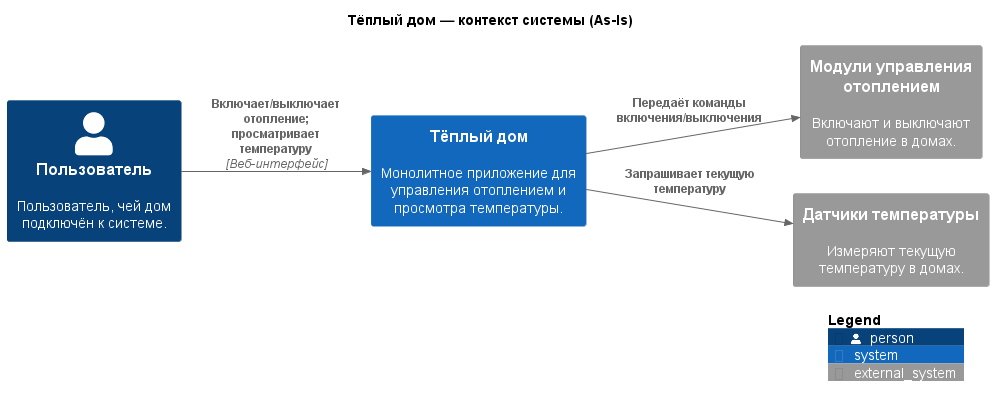

[Исходник диаграммы в PlantUML](docs/diagrams/as-is-context.puml).

Сервер инициирует передачу команд отопления и чтение температуры. Показания возвращаются в ответ на запрос сервера.

# Задание 2. Проектирование микросервисной архитектуры

**Диаграмма контейнеров (Containers)**

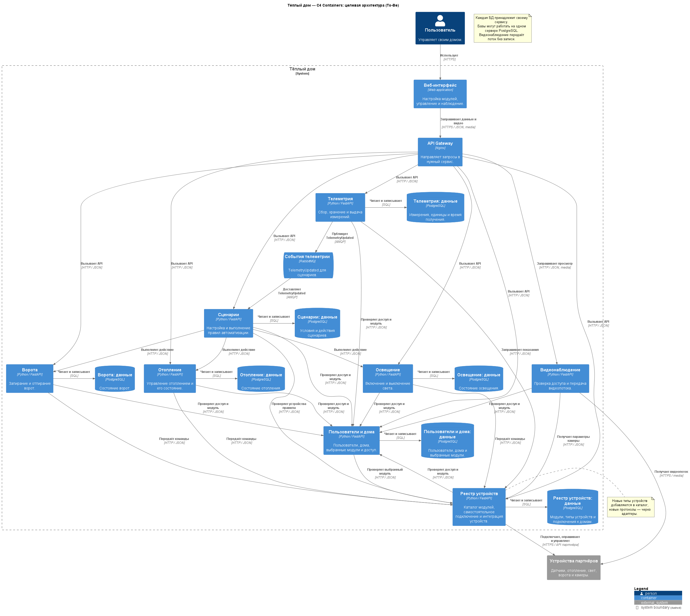

[PlantUML](docs/diagrams/to-be-containers.puml).

**Диаграммы компонентов (Components)**

Пользователи и дома:

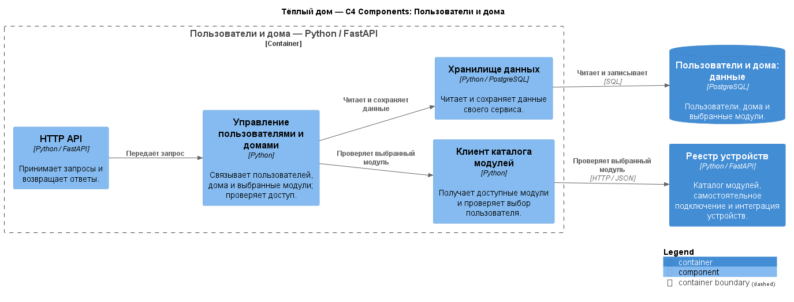

[PlantUML](docs/diagrams/to-be-components-homes.puml).

Реестр устройств:

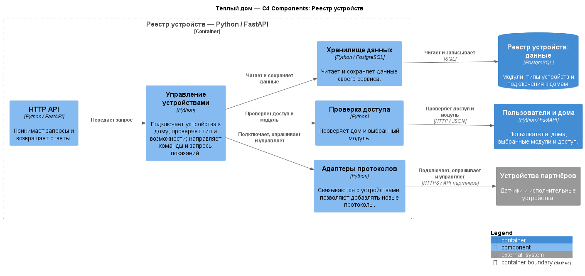

[PlantUML](docs/diagrams/to-be-components-registry.puml).

Отопление:

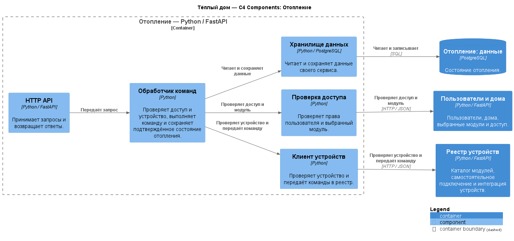

[PlantUML](docs/diagrams/to-be-components-heating.puml).

Освещение:

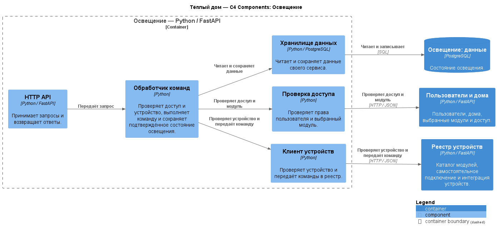

[PlantUML](docs/diagrams/to-be-components-lighting.puml).

Ворота:

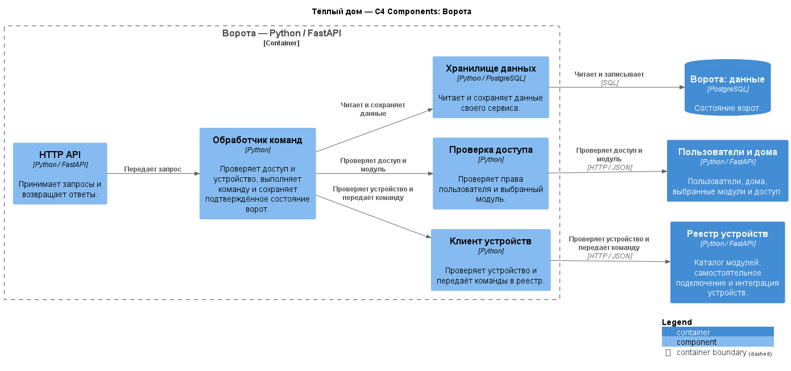

[PlantUML](docs/diagrams/to-be-components-gates.puml).

Видеонаблюдение:

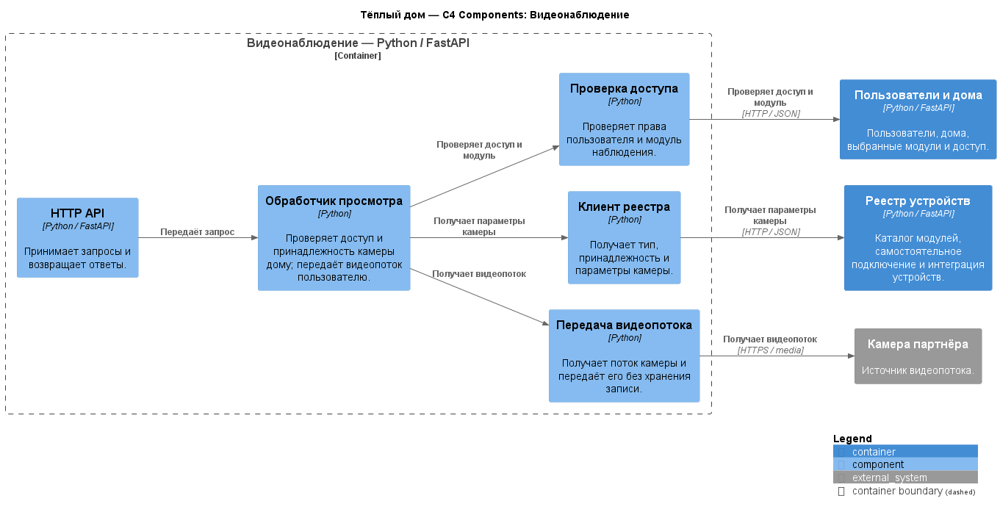

[PlantUML](docs/diagrams/to-be-components-surveillance.puml).

Телеметрия:

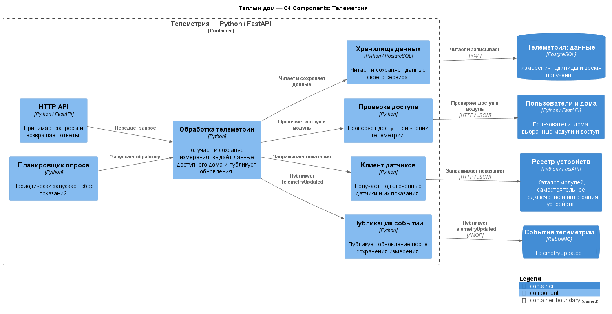

[PlantUML](docs/diagrams/to-be-components-telemetry.puml).

Сценарии:

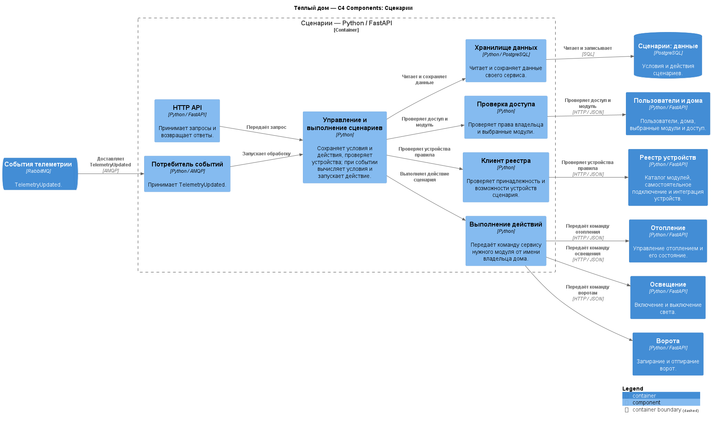

[PlantUML](docs/diagrams/to-be-components-scenarios.puml).

**Диаграмма кода (Code)**

Компонент «Обработчик команд отопления»:

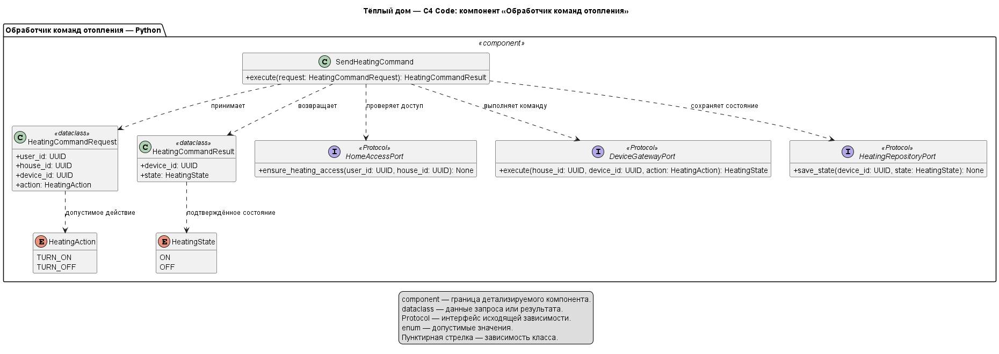

[PlantUML](docs/diagrams/to-be-code-heating-command.puml).

# Задание 3. Разработка ER-диаграммы

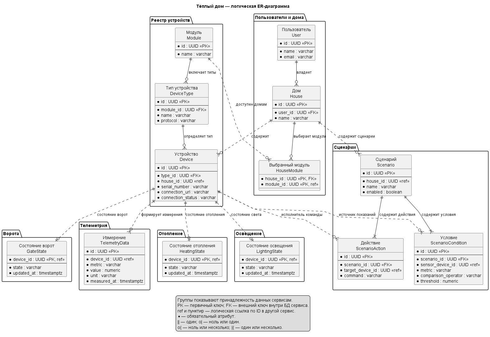

[PlantUML](docs/diagrams/to-be-er.puml).

# Задание 4. Создание и документирование API

### 1. Тип API

Для синхронных операций используется REST API по HTTP с JSON: вызывающему сервису нужен ответ с данными или результатом выполнения команды. Обновления телеметрии передаются асинхронно через RabbitMQ событием `TelemetryUpdated`, чтобы запускать сценарии независимо от пользовательских запросов.

### 2. Документация API

[Спецификация OpenAPI](docs/api/openapi.yaml) описывает пять REST-операций.

| Сервис | Метод и путь | Назначение |
| --- | --- | --- |
| Пользователи и дома | `GET /houses/{house_id}` | Дом и выбранные модули |
| Реестр устройств | `GET /devices/{device_id}` | Информация об устройстве |
| Реестр устройств | `POST /houses/{house_id}/devices` | Подключение устройства |
| Отопление | `POST /houses/{house_id}/heating/commands` | Включение и выключение отопления |
| Телеметрия | `GET /devices/{device_id}/telemetry/latest` | Последнее измерение выбранной метрики |

# Задание 5. Работа с Docker и Docker Compose

Приложение [`temperature-api`](apps/temperature-api/main.py) имитирует удалённый датчик: при каждом запросе генерирует новое значение температуры от 18 до 30 °C.

Поддерживаются два варианта запроса:

- `GET /temperature?location=Living%20Room` — по названию комнаты.
- `GET /temperature/1` — по идентификатору датчика.

Соответствия комнат: `1` — Living Room, `2` — Bedroom, `3` — Kitchen. Неизвестному идентификатору соответствует `Unknown`, неизвестной комнате — идентификатор `0`.

Ответ содержит `value`, `unit`, `timestamp`, `location`, `status`, `sensor_id`, `sensor_type` и `description`.

### Запуск

Скопируйте `apps/.env.example` в `apps/.env` и задайте `POSTGRES_PASSWORD` — случайный пароль из букв и цифр. Затем из каталога `apps` выполните:

```bash
docker compose up --build -d
```

Compose запускает PostgreSQL, `temperature-api` на порту `8081` и монолит на порту `8080`. При первом запуске PostgreSQL выполняет [`init.sql`](apps/smart_home/init.sql), который создаёт базу `smarthome` и таблицу `sensors`. Данные сохраняются в томе `postgres_data`.

### Проверка

Импортируйте [`smarthome-api.postman_collection.json`](apps/smarthome-api.postman_collection.json) в Postman:

1. Выполните **Create Sensor**.
2. Выполните **Get All Sensors** несколько раз — значение `value` температурного датчика будет обновляться при каждом запросе.

Для остановки выполните `docker compose down`.